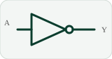
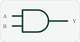
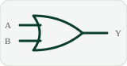
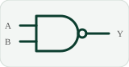
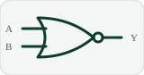
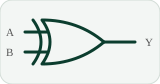
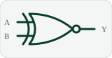

**CARRERA DE COMPUTACIÓN · 2.º CICLO "A"**

**ASIGNATURA:** DISEÑO DE CIRCUITOS
**DOCENTE:** ING. LUIS DARÍO SINCHE CUEVA, MG.
**ESTUDIANTE:** AYTANA MILENA SALINAS OVIEDO

---

## 📖 Introducción

Este portafolio digital reúne, de forma resumida y organizada, lo aprendido en la asignatura **Diseño de Circuitos**. Se avanza desde la representación binaria hasta circuitos que realizan cálculos, aplicando técnicas de **diseño clásico**: tablas de verdad, álgebra de Boole, mapas de Karnaugh y compuertas lógicas.

> 🎯 **Resultado de aprendizaje R1:** diseña e implementa circuitos combinacionales básicos utilizando técnicas de diseño clásico.

---

<h2 align="center">📚 Unidades</h2>

Pulsa sobre una unidad para entrar

      

---

| Unidad | Tema | Estado |
|:---:|:---|:---:|
| [**Unidad 1**](UNIDAD_1.md) | ✅ **Culminada** |
| Unidad 2 | ⏳ Próximamente |
| Unidad 3 | ⏳ Próximamente |

