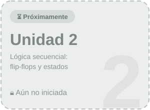
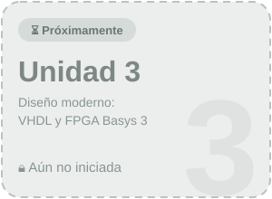

**UNIVERSIDAD NACIONAL DE LOJA**

**FACULTAD DE LA ENERGÍA, LAS INDUSTRIAS Y LOS RECURSOS NATURALES NO RENOVABLES**

**CARRERA DE INGENIERÍA EN COMPUTACIÓN**

**ASIGNATURA:** DISEÑO DE CIRCUITOS

**DOCENTE:** ING. LUIS DARÍO SINCHE CUEVA

**ESTUDIANTE:** AYTANA MILENA SALINAS OVIEDO

**CICLO:** 2A

**SEPTIEMBRE 2026 - FEBRERO 2027** 

---

  
## 📖 Introducción

Este portafolio digital reúne, de forma resumida y organizada, lo aprendido en la asignatura **Diseño de Circuitos**. Se avanza desde la representación binaria hasta circuitos que realizan cálculos, aplicando técnicas de **diseño clásico**: tablas de verdad, álgebra de Boole, mapas de Karnaugh y compuertas lógicas.

---
**Bienvenido a mi portafolio digital, aqui podrás encontrar mis trabajos y proyectos correspondiente al segundo ciclo. Para ver el contenido detallado, haz clic en la unidad que desee navegar:** 
---

<h2 align="center">📚 Unidades</h2>

---

| Unidad | Estado |
|:---:|:---:|
| [**Unidad 1**](UNIDAD_1.md) | ✅ **Culminada** |
| Unidad 2 | ⏳ Próximamente |
| Unidad 3 | ⏳ Próximamente |

---

  
## Declaración de IA
La inteligencia artificial se ha convertido en una herramienta fundamental en la sociedad contemporánea, permitiendo optimizar procesos, mejorar la toma de decisiones y automatizar tareas en diversos campos como la salud, la educación y la industria. Sin embargo, su uso responsable requiere considerar aspectos éticos como la privacidad, la transparencia y el impacto en el empleo, garantizando que su desarrollo beneficie a la humanidad de manera equitativa y sostenible.

Durante del desarrollo de mi portafolio en la unidad 1 hice uso de la IA (CLAUDE.IA) para generar los códigos correspondientes para modificación de textos, títulos, insertar las subacarpetas que contiene los temas de la unidad con la finalidad que mi portafolio se visualice de forma ordenada y creativo.
