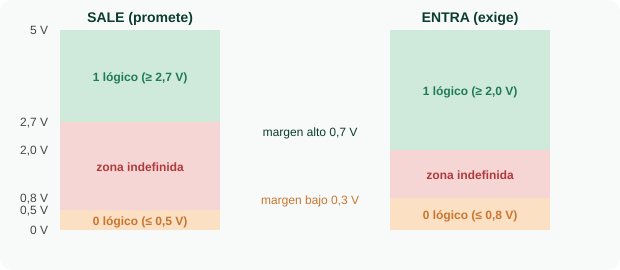
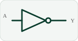
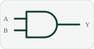
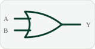
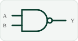
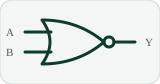
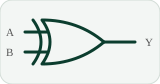
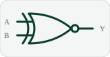

<h1 align="center">🔢 Semana 1 · Sistemas numéricos, códigos y compuertas</h1>

## 1️⃣ ¿Por qué el computador usa solo 0 y 1?

Un **transistor** es un interruptor controlado por voltaje: abierto = **0** (voltaje bajo) y cerrado = **1** (voltaje alto). Con solo dos estados es fácil distinguirlos aunque la señal llegue con ruido.

| Nivel (familia 74LS) | Sale (promete) | Entra (exige) |
|:---:|:---:|:---:|
| 1 lógico | ≥ 2,7 V | ≥ 2,0 V |
| 0 lógico | ≤ 0,5 V | ≤ 0,8 V |

- **Margen de ruido alto** = 2,7 − 2,0 = **0,7 V** · **Margen bajo** = 0,8 − 0,5 = **0,3 V**.
- Entre 0,8 y 2,0 V el chip no garantiza nada (causa típica: una entrada sin conectar).

## 2️⃣ Sistemas numéricos

En un sistema **posicional** cada posición vale una potencia de la base. Pesos del binario: `128 64 32 16 8 4 2 1`.
Ejemplo: `1011₂ = 8 + 0 + 2 + 1 = 11`.

| Conversión | Método | Ejemplo |
|:---|:---|:---|
| Decimal → binario | Dividir entre 2 y leer los restos de abajo hacia arriba | `25 = 11001₂` |
| Binario → hexadecimal | Grupos de 4 bits | `10011101₂ = 9D₁₆` |
| Binario → octal | Grupos de 3 bits | `10011101₂ = 235₈` |

| Dec | 10 | 11 | 12 | 13 | 14 | 15 |
|:-:|:-:|:-:|:-:|:-:|:-:|:-:|
| **Hex** | A | B | C | D | E | F |

**Suma binaria:** `0+0=0` · `0+1=1` · `1+1=10` (escribo 0 y llevo 1) · `1+1+1=11`.
Ejemplo: `1011 + 0110 = 10001` (11 + 6 = 17).

## 3️⃣ Números negativos: complemento a dos

Para obtener el negativo: **invertir los bits y sumar 1**. Ejemplo: `3 = 0011 → 1100 → 1101 = −3`.
Con 4 bits el rango es de **−8 a +7**. Restar = sumar el negativo (se reutiliza el sumador).

| Binario | Dec | Binario | Dec |
|:-:|:-:|:-:|:-:|
| 0000 | 0 | 1000 | −8 |
| 0001 | 1 | 1001 | −7 |
| 0010 | 2 | 1010 | −6 |
| 0011 | 3 | 1011 | −5 |
| 0100 | 4 | 1100 | −4 |
| 0101 | 5 | 1101 | −3 |
| 0110 | 6 | 1110 | −2 |
| 0111 | 7 | 1111 | −1 |

> ⚠️ **Desbordamiento:** `0111 + 0001 = 1000 → −8` ✗. Dos positivos dieron un negativo porque el resultado no cabe en 4 bits (en Java, un `int` pasa de 2147483647 a −2147483648).

## 4️⃣ Códigos

| Código | Qué es | Ejemplo | Uso |
|:---:|:---|:---|:---|
| **BCD** | Cada dígito decimal en 4 bits | `157 → 0001 0101 0111` | Displays, relojes, contadores |
| **Gray** | Entre vecinos cambia un solo bit | `000 001 011 010 110 111 101 100` | Encoders, mapas de Karnaugh |
| **ASCII** | Tabla de 7 bits (128 caracteres) | `A = 65 = 01000001` | Texto |

## 5️⃣ Las 7 compuertas lógicas

<table><tr><td align="center"> NOT · Y = A'</td><td align="center"> AND · Y = A·B</td><td align="center"> OR · Y = A+B</td><td align="center"> NAND · Y = (A·B)'</td></tr></table>

<table><tr><td align="center"> NOR · Y = (A+B)'</td><td align="center"> XOR · Y = A⊕B</td><td align="center"> XNOR · Y = (A⊕B)'</td></tr></table>

**NOT:** `A=0 → Y=1` · `A=1 → Y=0`

| A | B | AND | OR | NAND | NOR | XOR | XNOR |
|:-:|:-:|:-:|:-:|:-:|:-:|:-:|:-:|
| 0 | 0 | 0 | 0 | **1** | **1** | 0 | **1** |
| 0 | 1 | 0 | **1** | **1** | 0 | **1** | 0 |
| 1 | 0 | 0 | **1** | **1** | 0 | **1** | 0 |
| 1 | 1 | **1** | **1** | 0 | 0 | 0 | **1** |

| Compuerta | Regla en palabras |
|:---:|:---|
| AND | 1 solo si **todas** las entradas valen 1 |
| OR | 1 si **al menos una** vale 1 |
| NAND / NOR | Son AND / OR negadas (el círculo en la salida invierte) |
| XOR | 1 si las entradas son **distintas** (luz de escalera con 2 interruptores) |
| XNOR | 1 si las entradas son **iguales** |

> 💡 Con solo NAND (o solo NOR) se puede construir cualquier circuito. En el curso se usa la norma de dibujo **ANSI/IEEE**; la norma IEC usa rectángulos con símbolos (`&`, `≥1`, `=1`).

## 6️⃣ Circuitos integrados: 74LS08

El **74LS08** contiene 4 compuertas AND en un encapsulado DIP-14. Alimentación: **pin 14 = +5 V** y **pin 7 = GND**. Se cuentan los pines desde la muesca en sentido antihorario.

| Pin | 1 | 2 | 3 | 4 | 5 | 6 | 7 |
|:-:|:-:|:-:|:-:|:-:|:-:|:-:|:-:|
| Función | 1A | 1B | 1Y | 2A | 2B | 2Y | **GND** |

| Pin | 8 | 9 | 10 | 11 | 12 | 13 | 14 |
|:-:|:-:|:-:|:-:|:-:|:-:|:-:|:-:|
| Función | 3Y | 3A | 3B | 4Y | 4A | 4B | **VCC** |

**Código impreso `SN 74 LS 08 N`:** Texas Instruments · rango comercial · familia TTL · 4 AND de 2 entradas · DIP de plástico. Un 74HC08 es la versión CMOS con la misma función y pines.

---

[⬅️ Unidad 1](UNIDAD_1.md) &nbsp;&nbsp;|&nbsp;&nbsp; [🏠 Inicio](README.md) &nbsp;&nbsp;|&nbsp;&nbsp; [Semana 2 ➡️](SEMANA_2.md)

