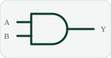
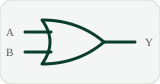
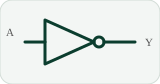
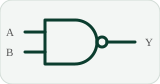
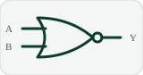

<h1 align="center">🧮 Semana 2 · Álgebra de Boole y formas canónicas</h1>

## 1️⃣ Un circuito y una expresión son lo mismo

<table><tr><td align="center"> AND = producto ( · )</td><td align="center"> OR = suma ( + )</td><td align="center"> NOT = complemento ( ' )</td></tr></table>

Ejemplo: `Y = A·B + C'` · **Precedencia:** NOT → AND → OR.

> 🔔 **Del enunciado a la especificación:** «la sirena suena cuando se activan dos sensores».
> Lectura 1 (exactamente dos): `Σm(3,5,6)` · Lectura 2 (**al menos dos**): `Σm(3,5,6,7)` ← la que pide el cliente.

## 2️⃣ Álgebra de Boole (postulados de Huntington)

Conjunto {0,1} con tres operaciones: `+` (OR), `·` (AND), `'` (NOT). **Dualidad:** al intercambiar `+ ↔ ·` y `0 ↔ 1` la identidad sigue siendo válida.

| Postulado | Forma OR | Forma AND (dual) |
|:---|:---:|:---:|
| Identidad | `X + 0 = X` | `X · 1 = X` |
| Complemento | `X + X' = 1` | `X · X' = 0` |
| Conmutativa | `X + Y = Y + X` | `XY = YX` |
| Distributiva | `X(Y+Z) = XY + XZ` | `X + YZ = (X+Y)(X+Z)` |

### Teoremas útiles

| Teorema | Forma OR | Forma AND |
|:---|:---:|:---:|
| Elemento nulo | `X + 1 = 1` | `X · 0 = 0` |
| Idempotencia | `X + X = X` | `X · X = X` |
| Absorción | `X + XY = X` | `X(X+Y) = X` |
| Absorción del complemento | `X + X'Y = X + Y` | `X(X'+Y) = XY` |
| Adyacencia | `XY + XY' = X` | `(X+Y)(X+Y') = X` |
| Consenso | `XY + X'Z + YZ = XY + X'Z` | `(X+Y)(X'+Z)(Y+Z) = (X+Y)(X'+Z)` |

## 3️⃣ Leyes de De Morgan

<table><tr><td align="center"> (A·B)' = A' + B'</td><td align="center"> (A+B)' = A'·B'</td></tr></table>

> 🔑 **Rompe la barra, cambia el operador.** Generaliza: `(A+B+C)' = A'B'C'`.

## 4️⃣ Minitérminos y maxitérminos

- **Minitérmino mᵢ** (producto, vale 1 en su fila): variable en 1 → sin complemento; en 0 → complementada.
- **Maxitérmino Mᵢ** (suma, vale 0 en su fila): variable en 0 → sin complemento; en 1 → complementada.
- Relación: `Mᵢ = (mᵢ)'`.

## 5️⃣ Formas canónicas SOP y POS · caso de la alarma

Bodega con 3 sensores: puerta (**A**), ventana (**B**) y movimiento (**C**). La sirena **F** suena si **al menos dos** sensores se activan.

| i | A | B | C | F | mᵢ | Mᵢ |
|:-:|:-:|:-:|:-:|:-:|:-:|:-:|
| 0 | 0 | 0 | 0 | 0 | `A'B'C'` | `A + B + C` |
| 1 | 0 | 0 | 1 | 0 | `A'B'C` | `A + B + C'` |
| 2 | 0 | 1 | 0 | 0 | `A'BC'` | `A + B' + C` |
| 3 | 0 | 1 | 1 | **1** | `A'BC` | `A + B' + C'` |
| 4 | 1 | 0 | 0 | 0 | `AB'C'` | `A' + B + C` |
| 5 | 1 | 0 | 1 | **1** | `AB'C` | `A' + B + C'` |
| 6 | 1 | 1 | 0 | **1** | `ABC'` | `A' + B' + C` |
| 7 | 1 | 1 | 1 | **1** | `ABC` | `A' + B' + C'` |

| Forma | Se leen | Resultado |
|:---:|:---|:---|
| **SOP** | las filas donde F = 1 | `F = Σm(3,5,6,7) = A'BC + AB'C + ABC' + ABC` |
| **POS** | las filas donde F = 0 | `F = ΠM(0,1,2,4) = (A+B+C)(A+B+C')(A+B'+C)(A'+B+C)` |

Los índices de ΠM son los que **faltan** en Σm. Se elige **SOP** si hay pocos 1 (o solo NAND) y **POS** si hay pocos 0 (o solo NOR).

## 6️⃣ Simplificar ahorra hardware

Con idempotencia y adyacencia: `A'BC + ABC = BC` · `AB'C + ABC = AC` · `ABC' + ABC = AB`.

<b><code>F = AB + AC + BC</code></b>

| Versión | Circuitos integrados | Total |
|:---|:---|:---:|
| Canónica | 7404 + 2×7411 + 7432 | ❌ **4 CI** |
| Simplificada | 7408 + 7432 | ✅ **2 CI** |

**Ejemplo:** `F = A + A'B + AB'C` → `(A + B) + AB'C` → **`A + B`** (absorción del complemento + absorción). De 5 literales a solo 2.

> 💡 El álgebra no garantiza llegar al mínimo; por eso en la semana 3 aparecen los **mapas de Karnaugh**.

---

[⬅️ Semana 1](SEMANA_1.md) &nbsp;&nbsp;|&nbsp;&nbsp; [🏠 Inicio](README.md) &nbsp;&nbsp;|&nbsp;&nbsp; [Semana 3 ➡️](SEMANA_3.md)

