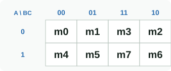
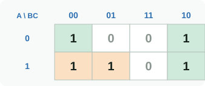
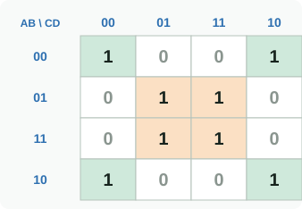
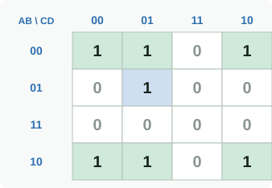
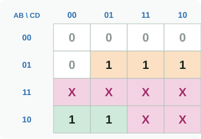
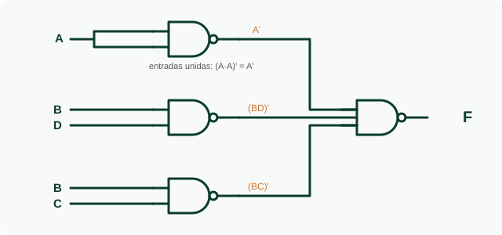

<h1 align="center">🗺️ Semana 3 · Mapas de Karnaugh, indiferentes y NAND/NOR</h1>

# 📘 Sesión 1 · Mapas de Karnaugh

## 1️⃣ ¿Por qué el orden 00, 01, 11, 10?

Se basa en el **teorema de adyacencia** (`XY + XY' = X`): si dos minitérminos difieren en una sola variable, esa variable desaparece. El **código Gray** hace que cada celda sea vecina lógica de la siguiente (¡y la última de la primera!).

<table><tr><td align="center"> Mapa de 3 variables</td><td align="center"> F = Σm(0,2,4,5,6) → <b>F = C' + AB'</b></td></tr></table>

## 2️⃣ Reglas para agrupar

| ✅ Válido | ❌ No válido |
|:---|:---|
| Grupos de **2ᵏ** celdas (1, 2, 4, 8, 16): un grupo de 2ᵏ elimina *k* variables | Formas en L o diagonales |
| Rectangulares y **lo más grandes posible** | Grupos que no son potencia de 2 |
| El mapa **se enrolla**: bordes y esquinas son vecinos | Ignorar los bordes opuestos |

**Cómo leer un grupo:** variable constante en 1 → `A` · constante en 0 → `A'` · si cambia → desaparece.

## 3️⃣ Mapas de 4 variables · SOP

<table><tr><td align="center"> Σm(0,2,5,7,8,10,13,15) → <b>F = B'D' + BD</b> (¡es una XNOR!)</td><td align="center"> Σm(0,1,2,5,8,9,10) → <b>F = B'C' + B'D' + A'C'D</b></td></tr></table>

- 🟩 **B'C'**: m0, m1, m8, m9 (bordes superior e inferior) · 🟩 **B'D'**: las 4 esquinas · 🟦 **A'C'D**: m1, m5.
- Resultado: 3 términos · **7 literales**.

### La misma función en POS (se agrupan los 0)

`F = (A'+B')(B'+D)(C'+D')` → **6 literales**. Lectura invertida: 0 → `A`, 1 → `A'`.
Conviene construir ambas formas y elegir la de **menor costo** (literales, compuertas y CI).

### Implicantes

| Término | Significado |
|:---|:---|
| **Implicante** | Cualquier grupo válido de 1 (o X) |
| **Implicante primo** | Grupo que ya no se puede agrandar |
| **Primo esencial** | El único primo que cubre algún 1: debe estar en la solución |

---

# 📗 Sesión 2 · Indiferentes y NAND/NOR

## 4️⃣ Condiciones indiferentes (X)

Un dígito BCD usa solo 10 de las 16 combinaciones: `1010` a `1111` nunca ocurren. Esas filas son **X**:

| Como 1 | Como 0 | Nunca solas |
|:---:|:---:|:---:|
| Si agranda un grupo, se incluye | Si no ayuda, se ignora | Un grupo solo de X agrega un término inútil |

Notación: `F = Σm(minitérminos) + d(indiferentes)`.

**Dígito BCD ≥ 5:** `F = Σm(5,6,7,8,9) + d(10–15)`

| | Expresión | Literales |
|:---|:---|:---:|
| Sin usar las X | `AB'C' + A'BD + A'BC` | 9 |
| Con X | **`A + BD + BC`** | **5** |

## 5️⃣ Universalidad NAND y NOR

| Función | Solo NAND | Solo NOR |
|:---:|:---:|:---:|
| NOT | `(A·A)'` | `(A+A)'` |
| AND | `((AB)')'` | `(A'+B')'` |
| OR | `(A'·B')'` | `((A+B)')'` |

> 🔁 **SOP mínima → NAND-NAND** (chips 7400/7410) · **POS mínima → NOR-NOR** (chip 7402).

### De SOP a NAND-NAND en 4 pasos

1. `F = A + BD + BC` (SOP mínima)
2. `F = ((A + BD + BC)')'` (doble negación)
3. `F = (A' · (BD)' · (BC)')'` (De Morgan)
4. `F = NAND( A', NAND(B,D), NAND(B,C) )`

| Versión | Circuitos integrados | Total |
|:---|:---|:---:|
| Sin usar las X | 7404 + 7411 + 7432 | 3 CI |
| Con X, AND-OR | 7408 + 7432 | 2 CI |
| Con X, solo NAND | 7400 + 7410 | 2 CI |

El ahorro viene de las **X**; la NAND no agrega chips y deja una sola familia en el inventario.

## 6️⃣ Proyecto integrador

| Semana | Unidad | Entrega |
|:---:|:---:|:---|
| 6 | 1 | Bloque combinacional: tabla de verdad, expresión mínima y esquema en Logisim-evolution |
| 11 | 2 | Se agrega memoria: diagrama de estados y flip-flops |
| 16 | 3 | Descrito en VHDL: simulación y configuración de la Basys 3 |

Equipos de 4 roles rotativos: **Especificación · Diseño · Verificación · Documentación**.

---

[⬅️ Semana 2](SEMANA_2.md) &nbsp;&nbsp;|&nbsp;&nbsp; [🏠 Inicio](README.md) &nbsp;&nbsp;|&nbsp;&nbsp; [Semana 4 ➡️](SEMANA_4.md)

