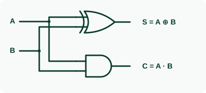
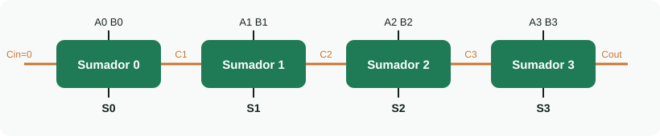
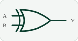

<h1 align="center">➕ Semana 4 · Circuitos aritméticos</h1>

## 1️⃣ Sumar un bit

Solo hay 4 casos. **S** = suma (lo que escribo) y **C** = *carry* / acarreo (lo que «me llevo»). Igual que `7 + 5 = 12` → escribo 2, llevo 1.

| Operación | Resultado | Escribo (S) | Me llevo (C) |
|:---:|:---:|:---:|:---:|
| 0 + 0 | 0 | 0 | 0 |
| 0 + 1 | 1 | 1 | 0 |
| 1 + 0 | 1 | 1 | 0 |
| 1 + 1 | 10₂ | 0 | 1 |

Ejemplo: `0110 + 0111 = 1101` (6 + 7 = 13). El acarreo de una columna entra a la siguiente: **se encadenan**.

## 2️⃣ Semisumador (columna 0)

| A | B | C | S |
|:-:|:-:|:-:|:-:|
| 0 | 0 | 0 | 0 |
| 0 | 1 | 0 | **1** |
| 1 | 0 | 0 | **1** |
| 1 | 1 | **1** | 0 |

`S = A ⊕ B` (XOR) · `C = A · B` (AND). «Semi» porque **no puede recibir acarreo**: solo sirve para la columna 0.

## 3️⃣ Sumador completo (columnas 1, 2, 3…)

**Truco:** cuenta los unos de la fila y escríbelos en binario (`Cout S`).

| A | B | Cin | # de 1 | Cout | S |
|:-:|:-:|:-:|:-:|:-:|:-:|
| 0 | 0 | 0 | 0 | 0 | 0 |
| 0 | 0 | 1 | 1 | 0 | **1** |
| 0 | 1 | 0 | 1 | 0 | **1** |
| 0 | 1 | 1 | 2 | **1** | 0 |
| 1 | 0 | 0 | 1 | 0 | **1** |
| 1 | 0 | 1 | 2 | **1** | 0 |
| 1 | 1 | 0 | 2 | **1** | 0 |
| 1 | 1 | 1 | 3 | **1** | **1** |

- **S = 1** cuando hay un número **impar** de unos → `S = A ⊕ B ⊕ Cin` (en el K-map es un «tablero de ajedrez»: no hay grupos).
- **Cout = 1** cuando hay **al menos dos** unos → `Cout = AB + A·Cin + B·Cin` (tres grupos de dos).

## 4️⃣ Sumador de 4 bits (ripple carry)

Regla única: **Cout de un sumador → Cin del siguiente**. El acarreo avanza como una ola, por eso el resultado se completa de derecha a izquierda.

> ⏱️ **Retardo ≈ 2 · n · 10 ns** (cada compuerta ≈ 10 ns y el acarreo cruza ≈ 2 por etapa)

| Bits | Compuertas | Tiempo |
|:-:|:-:|:-:|
| 4 | 8 | 80 ns |
| 16 | 32 | 320 ns |
| 32 | 64 | 640 ns |

Más bits → más lento.

## 5️⃣ Restar con el mismo circuito

`A − B = A + (−B)` donde `−B` = invertir los bits de B y sumar 1.
Ejemplo: `6 − 3` → `0110 + 1101 = 1 0011` → **`0011 = 3`** ✅ (el 1 sobrante se descarta).

<table><tr><td align="center"> La XOR es un inversor controlado: B ⊕ M</td></tr></table>

| M | B | B ⊕ M |
|:-:|:-:|:-:|
| 0 | 0 | 0 |
| 0 | 1 | 1 |
| 1 | 0 | 1 |
| 1 | 1 | 0 |

- **M = 0** → B pasa igual → **SUMA**
- **M = 1** → B se invierte → **RESTA** (además M se conecta al Cin del sumador 0 y aporta el +1)

## 6️⃣ Overflow

> ⚠️ `0101 (+5) + 0100 (+4) = 1001 → −7` ✗ (con 4 bits el rango es −8 a +7).
> **`V = C3 ⊕ C4`**: hay overflow si el acarreo que entra a la última etapa es distinto al que sale. **Cout = 1 NO significa error.**

## 7️⃣ Comparador de magnitud

| Pregunta | Cómo se resuelve |
|:---|:---|
| **¿A = B?** | XNOR en cada bit (1 si son iguales) y AND de todas |
| **¿A > B?** | Desde el bit más alto: el primer bit en que difieren decide. Integrado **7485** |

## 8️⃣ De aquí sale la ALU

<b>Sumador/restador + Comparador + AND/OR/XOR → Multiplexor (semana 5) → resultado de la instrucción</b>

**Demostración `0101 + 0011`:**

| Etapa | A | B | Cin | # de 1 | S | Cout |
|:-:|:-:|:-:|:-:|:-:|:-:|:-:|
| 0 | 1 | 1 | 0 | 2 | 0 | 1 |
| 1 | 0 | 1 | 1 | 2 | 0 | 1 |
| 2 | 1 | 0 | 1 | 2 | 0 | 1 |
| 3 | 0 | 0 | 1 | 1 | 1 | 0 |

Resultado `1000 = 8`: correcto sin signo, pero **con signo hay overflow**.

---

[⬅️ Semana 3](SEMANA_3.md) &nbsp;&nbsp;|&nbsp;&nbsp; [🏠 Inicio](README.md) &nbsp;&nbsp;|&nbsp;&nbsp; [Volver a la Unidad 1 ➡️](UNIDAD_1.md)

