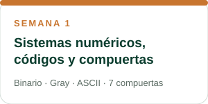
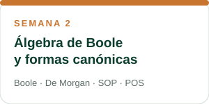
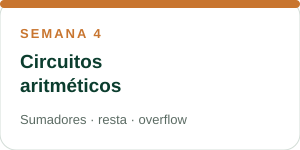

<h1 align="center">✅ Unidad 1 · Lógica combinacional con diseño clásico</h1>

<b>Estado: Culminada</b> · Haz clic en una semana para ver su resumen

---

## 🧭 Temas de la unidad

| Semana | Tema | Idea clave |
|:---:|:---|:---|
| 1 | [Sistemas numéricos, códigos y compuertas](SEMANA_1.md) | Todo se representa con 0 y 1 |
| 2 | [Álgebra de Boole y formas canónicas](SEMANA_2.md) | Un circuito y una expresión son lo mismo |
| 3 | [Mapas de Karnaugh, indiferentes y NAND/NOR](SEMANA_3.md) | Simplificar ahorra hardware |
| 4 | [Circuitos aritméticos](SEMANA_4.md) | Un circuito que suma y resta (base de la ALU) |

> 🔗 **Ruta de la unidad:** bits → compuertas → expresiones booleanas → simplificación → circuitos que calculan.

---

 &nbsp;&nbsp;|&nbsp;&nbsp; [🏠 Inicio](README.md) &nbsp;&nbsp;|&nbsp;&nbsp; [Semana 1 ➡️](SEMANA_1.md)

